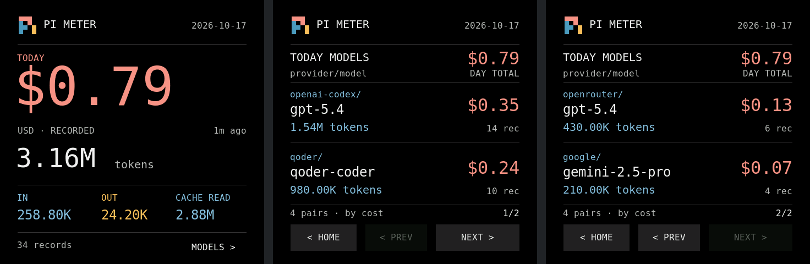

# Tokenmeter

把 Waveshare **ESP32-S3-Touch-AMOLED-2.16（480×480）**用作 Pi 今日 token 与日志费用桌面仪表。

采用左对齐布局与品牌配色：首页费用与总 token，明细按 `provider/model` 分组、每页两条、可按钮或上下滑动翻页。不 fork 旧桌面 App，不需要 Claude 订阅、用量 API、数据库或 Wi-Fi。

## 界面预览



以上为**当前固件真实 LVGL 界面代码的离线示例渲染，非实机截图或照片**。统计为合成示例，不代表真实用量、账单或模型定价；字库、页面布局与颜色均直接来自固件。

原尺寸单页：[首页](docs/images/home.png) · [明细 1](docs/images/models-1.png) · [明细 2](docs/images/models-2.png)。渲染说明见 [docs/images/README.md](docs/images/README.md)。

## macOS 一键脚本

先安装 Python 3.10+（推荐 3.14），然后在终端执行：

```sh
git clone https://github.com/HerbertGao/Tokenmeter.git
cd Tokenmeter
./start-daemon.sh
```

`start-daemon.sh` 首次创建项目 `.venv`、安装固定版本的 BLE 依赖，然后前台运行本地 daemon；后续复用环境并检查所需依赖。参数原样传给 daemon，按 `Ctrl+C` 停止：

```sh
./start-daemon.sh --pi-dir /path/to/pi-agent
./start-daemon.sh --once       # 只看统计，不装依赖、不连接蓝牙
./start-daemon.sh --help
```

**换电脑连接已经刷好的设备，不需要重新刷固件。** 先停止旧电脑的 daemon，新电脑开启蓝牙并允许终端/Python 的蓝牙权限，再运行启动脚本；不需要手动配对。

首次刷机或更新固件时，插入支持数据传输的 USB 线，在项目根目录运行：

```sh
./flash.sh
# 也可以明确指定 pio device list 中的串口
./flash.sh /dev/cu.usbmodemXXXX
```

`flash.sh` 自动在项目 `.venv` 安装 PlatformIO 6.2.0，再选串口。只有一个 ESP32 原生 USB 候选时显示该端口，多台时要求选择，不会默认取第一台；也可显式指定列出的串口。USB标识不等于板型保证，确认实物是 **ESP32-S3-Touch-AMOLED-2.16（16MB Flash / 8MB PSRAM）** 后输入 `FLASH`，才从当前源码构建并上传。刷机会覆盖现有固件；脚本不备份、不整片擦除、不提供跳过确认的参数。

首次准备需要联网下载 PyPI 包和 PlatformIO 构建依赖（使用项目 `.venv` 及 PlatformIO 用户缓存）。脚本不安装系统 Python、不用 sudo、不改系统蓝牙或权限、不装开机服务；损坏的现有 `.venv` 会报错而不是自动删除重建。若文件无执行权限，可用 `bash ./start-daemon.sh` 或 `bash ./flash.sh` 运行。当前仅提供 macOS 入口。

下面保留手动命令，便于排查环境或不使用脚本时操作。

## 先看本机统计，不需要设备

在项目根目录运行：

```sh
python3 -m daemon.tokenmeter --once
```

`--once` 仅需 Python 标准库，输出今日统计 JSON，不加载 Bluetooth。默认读 `PI_AGENT_DIR/sessions`；未设置时读 `~/.pi/agent/sessions`。

自定义或合并多个 Pi agent 目录：

```sh
python3 -m daemon.tokenmeter --once --pi-dir /path/to/pi-agent
python3 -m daemon.tokenmeter --once --pi-dir /path/to/agent-one --pi-dir /path/to/agent-two
```

`--pi-dir` 指包含 `sessions/` 的 agent 目录，不是会话文件或 `auth.json`。现有空目录是有效零用量；缺失目录、坏记录与缺价均显式标记，不能当成完整零账单。

## 手动运行 BLE daemon

建议 Python 3.10+；本机验证使用 Python 3.14 虚拟环境，已安装 Bleak 2.1.1。

```sh
python3 -m venv .venv
.venv/bin/python -m pip install -r daemon/requirements.txt
.venv/bin/python -m daemon.tokenmeter
```

首次实际扫描时，macOS 可能要求终端/Python 的 Bluetooth 权限。默认约60秒刷新，掉线重连；`--interval` 可设1–120秒。多台 Tokenmeter 同时存在时，使用 `--address` 指定设备地址；macOS 通常使用外设 UUID。

只连接新 Tokenmeter service，不会连接仍在运行旧 Clawdmeter 固件的设备。当前未自动启动 daemon，没有安装 LaunchAgent，也没有停止或修改旧服务。

## 固件

仅支持上述 ESP32-S3 2.16 板型：CO5300 QSPI、CST9220、AXP2101、PSRAM。保留必要显示/触摸/电源初始化；QMI8658 加速度计用于四向自动方向，不带 HID、声音或旧 splash。

使用 PlatformIO：

```sh
pio run -d firmware
```

首次编译会下载平台与库。字库来自 DejaVu Sans Mono，4bpp、固定像素字号；设备显示动态文本，不通过 BLE 传金额截图。具体字体来源、许可和重生成命令见 `firmware/fonts/`。

已在 ESP32-S3、8MB PSRAM、16MB Flash 的目标板验证上传和 Hash 校验。先用 `pio device list` 确认设备，并将下面的示例端口替换成自己的串口：

```sh
pio run -d firmware -t upload --upload-port /dev/cu.usbmodemXXXX
```

刷机会覆盖现有固件，请先确认板型、端口及是否需要备份。不要把其他板型当作兼容设备直接刷入。

## 方向与操作

保留现有 A+D 页面坐标、字号及按钮尺寸，没有新增大按钮或修改设计预览。

- 首页左滑进入明细，明细右滑回首页；反方向不重复切换。
- 明细上滑下一页、下滑上一页；第一页下滑仍留在明细。首页上下滑不翻页。
- GPIO18 自定义实体键消抖30ms后回首页，按住不连发；不是 BOOT、PWR 或 RESET，也不做双击/长按模式。
- QMI8658 加速度计约100ms采样，方向稳定400ms才切换四个正交方向。平放、接近45°边界或明显晃动时保持原方向；触摸期间暂停判向。
- 使用实机校准后的CST原生坐标，不再额外交换XY或镜像X；LVGL统一做显示旋转和触摸逆变换，按钮与滑动方向都相对当前画面。旋转不重置当前页和数据，仅多用38,400 bytes PSRAM条带缓冲。

屏内原按钮仍可点，也可从普通/灰色按钮区域起手滑动。沿有效方向达到50px即切页，不必松手；同一次按住只导航一次。滑动后不再触发按钮，快速松手也复核最终位置，防止拖入HOME等按钮误点。未变化的文字、字体和页面可见性不重复设置，避免无变化重绘整块页面。

屏幕常规定时刷新为每60秒，最近更新时间按整数分钟显示（`0m ago`、`1m ago`，满小时后显示小时）。新快照、连接变化和120秒STALE/跨日状态变化仍立即刷新；滑动、按钮及方向检测节奏不变。daemon默认本就每60秒推送，无需改参数。

## 用量与协议

统计主机本地自然日，按日志中明确的 provider 与 model/responseModel 配对。复制进 fork 的稳定 ID 记录只计一次；工具、摘要和独立 usage 事件均处理，缺少归属进入 unknown。输入、输出、缓存读取与写入按 Pi 原生口径求和，不重复叠加 reasoning。Qoder 兼容 usd_equivalent。

金额以日志 USD 为准，不是供应商最终账单。缺价显示未知或已知小计，不从 token 猜费用。设备在120秒未更新或跨本地午夜时自行标 stale，不把旧数据改称今日数据。

- [完整用量口径与已知边界](docs/usage.md)
- [BLE v1、内存上限与屏幕状态](docs/protocol.md)

JSONL 容器在本机进程内解析，但仅缓存/输出/发送允许的用量字段；不保留或发送正文，不读取认证文件。当前 BLE 未认证、未加密，附近客户端可能注入数据，仅适合可信近距环境；这不是可信计费终端。

设备快照上限64KiB、256个分组、每个身份192 UTF-8字节。超限显示 unavailable，不静默丢弃条目。原始身份保留；初版字体只覆盖 ASCII 与常用标点，其他文字有显示限制。

## 检查

主机测试不访问真实日志、Bluetooth 或硬件：

```sh
python3 -m unittest discover -s daemon/tests -v
python3 -m unittest discover -s scripts/tests -v
```

脚本测试通过临时目录和替身覆盖首次venv准备、参数/空格路径、串口选择、取消和上传失败；不会实际联网安装、刷机或连接蓝牙。

包含 fork 去重、跨 provider 同名模型、失败用量、Qoder、工具/摘要/独立 usage、缺价、DST/跨日、重写缓存、协议边界和 MTU/ACK。手动只读检查本机日志使用 `--once`。

已完成本机冻结元数据对账：独立 Node 去重和 Qoder 归一化后，调用已安装 Pi 的原生 `getUsageCostBreakdown`，与 Python 的费用、token、记录数一致。临时元数据随检查删除。未安装 ccusage，未宣称已通过 ccusage 全账本核账。

固件已在本机交叉编译通过，镜像位于 `firmware/.pio/build/waveshare_amoled_216/firmware.bin`（约1.02MB）；分钟刷新版静态 RAM 为36,232 bytes；分钟刷新版实机初始化空闲内部 RAM 为169,040 bytes、PSRAM为7,906,804 bytes，满负载峰值和长时间运行余量尚未测量。已转换六档 LVGL 字库，并校正为确认样图的品牌色和完整 Pi 小标。

首次构建获取依赖后，可运行固件的 ASan/UBSan 主机自检；可选参数是 `--once` 的 JSON 输出文件：

```sh
sh firmware/checks/run.sh
python3 firmware/checks/minute.py
python3 firmware/checks/rotation.py
sh firmware/checks/run.sh /tmp/tokenmeter-live.json
```

主机自检和 Python→固件交叉解析已覆盖真实快照、空日、不可用、缺价、部分价格、部分源、192字节UTF-8身份、256分组和金额/计数上限。它们不证明真实触摸、显示、电源时序或 BLE 并发正确。独立 daemon 核查未发现阻塞项；配置 Pyright CLI 为0错误。常驻 LSP 的旧解释器/工作区没有刷新，相关导入提示已用正确环境的类型检查及运行测试核实为误报，没有通过源码 ignore 掩盖问题。

## 实机验证与限制

已在目标板验证启动、PSRAM、显示/PMU/触摸初始化、四向方向、按钮定位和最新的左滑进入/右滑返回规则。真实 BLE 使用 MTU185，完整快照收到通知和读取 ACK 均为 `ok`；重启后身份稳定并可再次连接推送。主机回归和独立 review 未发现阻塞项，但不等于长期可靠性认证。

固件使用芯片地址派生的稳定 static-random BLE 身份，与旧 Clawdmeter 的 factory/public 身份分开，避免复用旧 HID 的服务缓存。身份只在 RAM 中设置，不新增 NVS/eFuse 配置写入。满负载并发、峰值/长期内存、I²C故障注入及 CPU/功耗降幅尚未测量。

没有常驻更新或开机自启。要持续更新，在项目根目录手动运行 `.venv/bin/python -m daemon.tokenmeter`；停止推送120秒后显示 STALE 属正常行为。

## 参考与许可

板级引脚、硬件 API 与初始化顺序参考 [Clawdmeter](https://github.com/HermannBjorgvin/Clawdmeter) 的同款设备支持；没有引入旧桌面 App、HAL 或其他板型。字体及生成字库的第三方许可见 [firmware/fonts/LICENSE-DejaVu.txt](firmware/fonts/LICENSE-DejaVu.txt)，PlatformIO 依赖由各自上游提供。

本仓库暂未声明项目整体开源许可证。公开源码不改变第三方组件的许可，也不代表对参考工程的源码另行授予再分发许可。
